<p align="center">
  
</p>

<h1 align="center">Sculk</h1>

<p align="center"><a href="README.md">English</a> · <b>Українська</b></p>

Розподілений сервер Minecraft: Java Edition 26.3 на Rust. Мета — тисячі гравців в одному безшовному світі з грою, яку
гравець не відрізнить від ванільного сервера.

Світ ділиться на **мікросвіти (MW)**: кожен має свій тік і свої чанки, мікросвіти ростуть разом із гравцями,
зливаються, коли гравці зустрічаються, і діляться, коли розходяться. Вони працюють паралельно на багатьох воркерах,
а світ зберігає окрема СУБД **AnvilDB**. Концепція й архітектура — у [docs/uk/](docs/uk/README.md), стан робіт — у
[PLAN.uk.md](PLAN.uk.md).

> Статус: ранній, але граний. Ванільну гру дає рушій [Horizon](https://github.com/horizon-rust/horizon) (Minecraft
> Java 26.3, переписаний на Rust); Sculk додає кластер, AnvilDB, оренди чанків, мікросвіти й перенесення гравців між
> рушіями без розриву з'єднання. Що перевірено і що ні — у [PLAN.uk.md](PLAN.uk.md).

## Що вміє

- Вхід з ванільного клієнта 26.3, online-mode (шифрування, сесійний сервер Mojang, скіни)
- Ванільна гра на рушії Horizon: генерація світу, моби, редстоун, Незер, Енд, торгівля, PvP
- Мікросвіти: розподіл гравців по рушіях, злиття при зустрічі, розщеплення, переїзд без розриву з'єднання
- Спільні для кластера чат, таб-лист, `/list`, `/tp`, час, погода, оператори, whitelist, бани
- AnvilDB: ванільна тека світу (копіюється туди й назад як є), оренди з fencing, LZ4, архів холодних регіонів (і в S3)
- Надійність: смерть воркера без відключення гравців, плавний перезапуск (drain), робота під час недоступності AnvilDB
- Вебконсоль з картою мікросвітів, Nether Tunnel (транспорт поверх UDP), chaos-тест

## Ролі

Один бінарник `sculk`, кілька ролей:

| Роль | Що робить |
| --- | --- |
| `sculk io` | Точка входу гравців: логін, online-mode, маршрутизація й перенесення гравців між рушіями |
| `sculk worker` | Запускає рушій гри (`sculk-engine`, Horizon із хуками Sculk) для своїх мікросвітів |
| `sculk anvildb` | СУБД світу: чанки, дані гравців, глобальний стан, оренди |
| `sculk dev` | Усе в одному процесі, для розробки й невеликих серверів |
| `sculk prepare` | Дані гри 26.3 з `server.jar` |
| `sculk tunnel` | Nether Tunnel на боці гравця |

## Запуск

Потрібно:

- Rust (stable) і `protoc`;
- рушій Horizon поруч із кодом: `tools/horizon.sh setup` (клон Horizon на коміті з `patches/horizon/BASE` плюс патчі
  Sculk);
- підготовлені ресурси Minecraft 26.3 для Horizon (`horizon-prepare --prepare --server-jar ...`, або тека
  `.local/horizon-client/26.3` лаунчера Horizon). Їх готуєте ви зі своєї копії гри: нічого від Mojang Sculk не
  поширює;
- ваша згода з [EULA Minecraft](https://aka.ms/MinecraftEULA) (`SCULK_EULA=true`).

### Локально

```sh
cargo build --release -p sculk -p sculk-engine
target/release/sculk prepare                 # один раз: дані гри 26.3
SCULK_ENGINE=target/release/sculk-engine \
SCULK_RESOURCES=<ресурси Horizon>/26.3 \
SCULK_EULA=true \
SCULK_PROPERTIES=config/server.properties \
target/release/sculk dev --workers 2
```

Підключайтесь до `localhost:25565`. Консоль сервера — той самий термінал (`op <нік>`, `whitelist ...`, `stop`).

### Docker

```sh
cp .env.example .env    # SCULK_EULA=true і HORIZON_RESOURCES="<шлях до 26.3>"
tools/docker.sh up      # збирає образ і піднімає AnvilDB, IO та воркери
```

Налаштування гри (`server.properties`, `server-icon.png`, `ops.json`, датапаки, моди Horizon) — у `config/`.
Світ живе в томі `anvildb-data`. Вебконсоль: `http://127.0.0.1:7180`.

## Розробка

```sh
cargo test --workspace
cargo clippy --workspace --all-targets
tools/chaos.sh --workers 3 --bots 12      # chaos-тест під ботами Horizon
```

Зміни в Horizon робляться комітами на гілці `sculk` у `external/horizon` і експортуються в `patches/horizon/`
(`tools/horizon.sh export`).

## Автори

- Dmytro Kostyshyn — автор, концепція й архітектура
- Claude (Anthropic) — співавтор коду (Claude Code)

Повний список — у [AUTHORS](AUTHORS). Sculk будується на [Horizon](https://github.com/horizon-rust/horizon) (MIT).
Логотип — оригінальний піксель-арт, не текстура гри.

## Ліцензія

[MIT](LICENSE). Minecraft — торгова марка Mojang AB; Sculk не пов'язаний із Mojang чи Microsoft.
