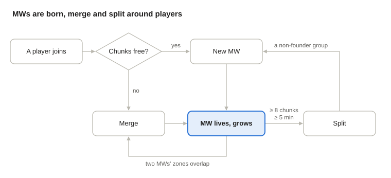
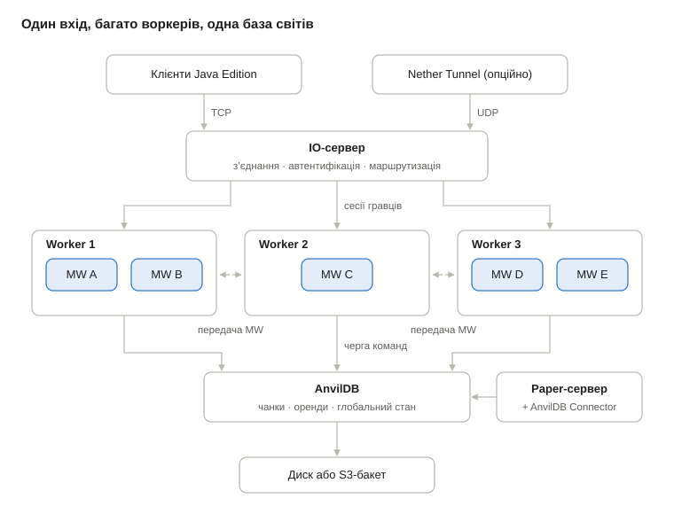
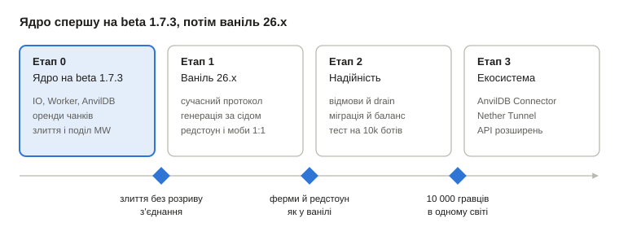

# Sculk — the concept of a distributed Minecraft server

*English · [Українська](uk/SCULK.md)*

7 November 2026

## 1. Introduction and goal

Sculk is an open source Minecraft: Java Edition server written in Rust. Its goal is 10,000+ players in one seamless world, behaving so that a player cannot tell it from a vanilla server.

### The problem

A vanilla server has a single game loop: 20 ticks a second, 50 ms a tick. Every chunk, entity and player is processed on one thread. Extra CPU cores barely help, so even a powerful server runs into a wall at a few hundred players.

### The idea: a world as an organism of cells

Instead of one game loop, Sculk runs thousands of independent ones: **micro worlds (MW, Micro World)**. Every player always lives in exactly one MW, and an MW behaves like a small vanilla server with its own mobs, ticks and redstone.

MWs behave like cells:

- they **grow** as their players move;
- they **merge** when players come close to each other;
- they **split** when players stay apart for a long time.

Since players on large servers are usually spread across the map, thousands of MWs tick in parallel on many cores and many machines.

### How Sculk differs from similar projects

- **Folia** (PaperMC) divides the world into regions that merge and split, but works within one process.
- **MultiPaper** distributes chunk ownership among several servers, but each server remains a regular Paper.
- **Sculk** ties regions to players, spreads them over a cluster of workers, keeps the world in a separate database, **AnvilDB**, and is written from scratch in Rust.

### Non-goals

- A thousand players in one spot. One MW is limited to one core, and that is a deliberate trade-off (chapter 13).
- Support for mods and Paper's Java plugins.

The project started in 2023 under the name IWM ([prototype](https://github.com/DmytroFrame/iwm)). Sculk is its new name and a rethought architecture.

## 2. Glossary

Component names stay in English; the other terms are explained here.

| Term | Meaning |
| --- | --- |
| **MW (Micro World)** | An independent game loop that owns a set of chunks and processes all players and entities in them |
| **MW zone** | All chunks within view distance of every player of that MW |
| **Lease** | An MW's exclusive right to read and write a chunk. Granted by AnvilDB, has a time to live (TTL) and is renewed |
| **Merge** | Handing all state of one MW to another when their zones overlap |
| **Split** | Moving a group of players into a new MW when they have been far from the rest for a long time |
| **IO** | The entry server: holds client connections, authenticates, manages workers |
| **Worker** | A processing server: ticks many MWs at once. Has a 16-bit Worker ID from IO |
| **AnvilDB** | The database of Minecraft worlds: chunks, global state, leases |
| **Entity ID** | The integer the Java protocol uses for an entity in packets. Lives only while the server runs |
| **UUID** | The permanent identifier of an entity or player in storage |
| **View distance** | The radius of chunks the server sends to the client |
| **Simulation distance** | The radius of chunks that are ticked |
| **Nether Tunnel** | An optional client program with its own UDP transport |
| **AnvilDB Connector** | A plugin for Paper servers that lets them keep their worlds in AnvilDB |

## 3. Micro worlds (MW)

An MW is the unit of game logic: one game loop that holds leases on its zone of chunks. At any moment every player belongs to exactly one MW. Inside an MW everything runs on one thread in vanilla's order, and that is what gives 1:1 behaviour.

A merge happens as soon as zones overlap, a split only after a stable gap. So MWs do not "flicker" between these states.

### Zone and leases

An MW's zone is the union of squares of view-distance radius around each of its players. The MW holds AnvilDB leases on every chunk of its zone, so nobody else can change them.

- Within **simulation distance**, chunks are ticked.
- The rest of the zone is loaded and sent to clients, but not ticked.
- Chunks outside any zone are frozen, as in vanilla. The world does not live where there are no players.

Since the merge already happens at view distance, players of different MWs never see each other's chunks. So neither "shadow" entities nor subscriptions to other MWs' chunks are needed.

### Birth

1. A player connects, and IO assigns it a worker.
2. The worker asks AnvilDB for leases on the zone around the player's position.
3. If all chunks are free, a new MW is born, and this player becomes its **founder**.
4. If even one chunk is already leased, the player goes straight into the owning MW through the merge procedure.

### Growth

When a player moves, the zone moves with it. The worker leases the new chunks and releases the old ones after saving them to AnvilDB.

### Merge

**Condition:** MW B tries to lease a chunk already leased by MW A, that is, their zones met at view distance. The initiator is always the worker.

1. AnvilDB refuses B the lease and names the owner: MW A on worker W(A).
2. Worker B stops ticking its MW and serializes all its state: players, entities, block entities, scheduled ticks, leases.
3. The state goes to worker A over the Worker↔Worker channel. If both MWs are on the same worker, the transfer happens in memory.
4. AnvilDB atomically rewrites B's leases to A.
5. If the workers differ, IO switches B's players' connections to worker A.
6. MW A takes in the state and goes on ticking. MW B is destroyed.

The client does not reconnect; it only sees a short pause. The target merge duration is at most 200 ms.

**Simultaneous merge:** if A and B run into each other in the same tick, the MW with the lower ID absorbs the other. *(Proposal.)*

### Split

**Condition:** the players of one MW formed two or more groups whose zones are at least **8 free chunks** apart, and this has lasted at least **5 minutes**. Both values are configurable.

1. The group with the MW's founder stays in it.
2. For every other group the worker creates a new MW. Its founder is a player who had no MW of its own.
3. The chunks, entities and leases of the group's zone go to the new MW.
4. The new MW may later migrate to another worker to balance the load.

**Why there is no "flicker":** a merge happens at zero gap between zones, a split only at a gap of 8 chunks for 5 minutes. This hysteresis keeps MWs from merging and splitting endlessly.

### Limits

One MW ticks on one core. Depending on the CPU, the practical limit is **200–500 players** in one MW. There is no mechanism to divide a dense MW: if a thousand players gather in one spot, the server will be slower there, and that is a deliberate trade-off.

### Defaults

| Parameter | Value | Status |
| --- | --- | --- |
| Zone radius | the server's view distance | decided |
| Split gap | 8 chunks | decided |
| Time before a split | 5 min | decided |
| Longest merge pause | 200 ms | decided |
| Save interval | 5 s | decided |
| Lease TTL | 10 s | proposal |

## 4. Cluster architecture

Sculk is built like a web service: an entry server for incoming traffic (IO), processing servers (Worker) and a central database (AnvilDB). All three roles live in **one Rust binary**, and the role is chosen at start.

Players connect only to IO, which spreads them over the workers. Workers tick MWs, hand them to each other on merges and migrations, and keep the world in AnvilDB through a command queue.

### One binary, three roles

| Command | Role | Instances |
| --- | --- | --- |
| `sculk io` | Player entry, authentication, worker management | 1 (in v1) |
| `sculk worker` | Game logic, MW ticks | As many as you like |
| `sculk anvildb` | Database of worlds and leases | 1 |

One binary makes deployment simpler and guarantees that every service speaks the same protocol version. For a small server all three roles can run on one machine; for a large one they spread over a cluster. Since AnvilDB also serves regular Paper servers, it can run apart from the rest of Sculk.

## 5. IO server

IO is the cluster's only entry point. It holds every Java client connection and manages the workers, but runs no game logic itself. In v1 there is one IO server (its limits and the way forward are in chapters 13 and 15).

### Duties

- **Accepting connections:** handshake, status/ping for the server list, login.
- **Authentication:** checking the player with Mojang's session server and encrypting the connection.
- **Worker registry:** handing out 16-bit Worker IDs, heartbeats, the load of every worker.
- **Placement:** a new player goes to the least loaded worker. If its zone overlaps an existing MW, the player goes to the owning worker.
- **Routing:** a "session → worker" table. On an MW merge or migration IO switches the route without breaking the connection.
- **Handing out entity IDs** to workers in blocks (chapter 9).
- **Global chat and tab list**, since only IO sees all players at once. *(Proposal.)*

### Sharing the packet work

So that IO does not become the bottleneck at 10,000 players, the heavy packet work is done by workers. *(Proposal.)*

- The worker builds game packets and **compresses** them.
- IO only **encrypts** the already compressed stream and sends it to the client.
- Between IO and a worker, a player's packets travel as opaque bytes, without re-encoding into protobuf.

### Keeping connections when a worker fails

1. IO notices that a worker no longer answers heartbeats.
2. Client connections stay open: IO answers keep-alives itself.
3. IO releases the dead worker's leases in AnvilDB.
4. The players are assigned to other workers, which restore their MWs from the last saved state.
5. The client gets the world and its position again, so it sees a short "freeze" instead of a kick.

The progress lost is bounded by the save interval (5 s).

### Planned worker restart (drain)

IO puts the worker into drain mode: it gets no new players, and all its MWs migrate to other workers by the same mechanism as a merge. After that the worker can be restarted safely.

## 6. Worker

A worker runs the game logic of many MWs at once. Think of it as a "cell processor": it knows nothing about the world as a whole, only about the MWs entrusted to it.

### Threading model

- A pool of OS threads, one per core.
- Every 50 ms the scheduler lays the MWs out over the threads. An MW ticks on only one thread at a time, so inside an MW the logic is single-threaded and deterministic, as in vanilla.
- Small MWs share a thread. A large MW takes a whole core.
- Network work (connections to IO, AnvilDB and other workers) runs on a separate asynchronous Tokio runtime and does not block ticks.

### An MW tick

A tick follows a vanilla server's order: players' incoming packets, time and weather (from the global clock), chunk ticks, scheduled block ticks, entities, block entities, outgoing packets. The aim is for redstone, farms and mechanics to behave exactly as in vanilla.

### The connection to AnvilDB

Every worker holds one permanent connection to AnvilDB with a **command queue**:

- lease requests, renewals and releases;
- chunk loading;
- asynchronous flushing of changed chunks every ~5 s;
- reading and writing global state and player data.

The queue lets commands be grouped into batches and lets the worker skip waiting for answers it does not need.

### World generation

New chunks are generated by the worker from the world seed and handed to AnvilDB at once. Generation must match vanilla, so that the same seed gives the same world. A worker can also work with the project's own block and entity types.

### Migrating an MW between workers

To balance the load, or before a restart, an MW moves to another worker by the same mechanism as a merge: freeze, serialize, transfer, rewrite the leases, switch IO's routes, go on ticking.

## 7. AnvilDB

AnvilDB is a separate database for Minecraft worlds. It stores chunks and global state, grants chunk leases and speaks protobuf. Both Sculk's workers and regular Java servers (through a plugin, chapter 12) can use it.

### Data model

The structure is like a relational database:

- a **database** → holds **worlds**;
- a **world** → holds **dimensions** (overworld, nether, end, custom ones), which work like tables;
- a **dimension** → holds regions and chunks, and the chunks' metadata.

At the world level lives the global state: time of day, weather, gamerules, world border, scoreboard, player data (inventory, position, statistics).

### Chunk leases

AnvilDB is the single source of truth about who owns a chunk. For every chunk it knows the MW, the worker and when the lease expires.

| Operation | What it does |
| --- | --- |
| `acquire` | Atomically leases a set of chunks. If even one is taken, returns its owner |
| `renew` | Extends leases while the worker is alive |
| `release` | Releases leases after the chunks are saved |
| `transfer` | Atomically moves leases from MW to MW on a merge, split or migration |
| `owner` | Returns a chunk's metadata and current owner |

Every lease carries a **generation number** (fencing token). A write with an old number is refused, so a worker that "hung" and lost its lease cannot corrupt the data. *(Proposal.)*

### Storage formats

- **Classic** — compatible with Anvil (`.mca`), so a world can be taken from a regular server and given back.
- **Optimized** — AnvilDB's own format for faster reads and writes and better compression.

A CLI tool imports and exports worlds between the formats. It fits as a subcommand of the same binary: `sculk anvildb import` / `sculk anvildb export`. *(Proposal.)*

### Storage and archive

- Files are kept on the instance's local disk or in an **S3-compatible bucket**.
- Regions nobody has visited for a long time go to the **archive**: they are compressed harder and moved to cold storage. When a player comes there, they come back on request.

## 8. Protocols between services

All internal services talk protobuf. The transport is gRPC with bidirectional streams, as in the IWM prototype. The protocol can be replaced with a faster one if gRPC turns out to be the bottleneck. From outside, the client sees only the standard Java Edition protocol.

| Channel | Transport | What goes over it |
| --- | --- | --- |
| Client → IO | Java Edition protocol (TCP) or Nether Tunnel (UDP) | The player's game traffic |
| IO ↔ Worker | gRPC stream | Players' packets as opaque bytes; control commands: assign a session, switch, drain |
| Worker ↔ Worker | gRPC stream | An MW's serialized state on a merge, split or migration |
| Worker ↔ AnvilDB | gRPC stream with a command queue | Leases, chunks, global state, player data |
| IO ↔ AnvilDB | gRPC | Releasing dead workers' leases, global state |
| AnvilDB Connector ↔ AnvilDB | gRPC | Chunks and world state for regular Paper servers |

One binary holds every role, so the `.proto` schemas and the serialization code are shared by all services and cannot drift apart between versions.

## 9. Global state and identifiers

Everything about the world as a whole lives in AnvilDB, and everything local lives in an MW on a worker. Entity identifiers are handed out so that a merge never needs renumbering.

### What lives where

| Data | Where | Who changes it |
| --- | --- | --- |
| Time of day, weather, gamerules, world border, scoreboard | AnvilDB | Only AnvilDB counts time; MWs change the state with a command to AnvilDB (such as `/time set`) |
| Player data | AnvilDB | The MW the player is in now |
| Chunks and blocks | AnvilDB | The MW holding the lease |
| Villagers, raids, the Ender Dragon, other local mechanics | Worker, in the MW | The MW itself |
| Chat, tab list | IO | IO *(proposal)* |

Workers sync their clock with AnvilDB now and then, so all MWs see the same time of day.

### Entity ID

In the Java protocol a UUID travels only in an entity's spawn packet. Every later packet (movement, metadata, a hit, removal) refers to the integer entity ID. Beta 1.7.3 has no UUIDs at all. If two MWs hand out the same IDs, after a merge the client confuses the entities.

**Decision:** entity IDs are globally unique across the cluster.

1. IO hands IDs to workers in blocks, for example 4096 at a time.
2. A worker gives IDs from its block to new entities in its MWs.
3. When the block runs out, the worker asks for the next one.
4. On a merge, entities keep their IDs, since they are already unique.

### UUID

A UUID is the permanent identity of a player or entity in storage. An entity ID exists only while the server runs and is never saved.

## 10. Reliability and failures

A crash of any worker costs players at most 5 seconds of progress and a short "freeze". A crash of IO disconnects every player in v1.

### Saving state

A worker keeps its MWs' chunks in memory. The lease guarantees nobody else changes them, so every change need not be written synchronously. Changed chunks and player data are flushed to AnvilDB asynchronously:

- every ~5 seconds;
- before a lease is released;
- on merges, migrations and a regular shutdown.

### Failure scenarios

| What happened | What the system does | What is lost |
| --- | --- | --- |
| A worker crashed | IO notices it by heartbeat, releases the leases, moves the players to other workers, MWs are restored from AnvilDB | Up to 5 s of progress |
| A worker hung but is alive | Leases are not renewed and expire by TTL. Late writes are refused by the generation number | Up to 5 s of progress |
| AnvilDB is unreachable | MWs keep ticking on the chunks in memory, writes pile up in a queue. No new leases are granted, so players cannot leave their zones *(proposal)* | Nothing, if AnvilDB comes back before the queue overflows |
| IO crashed | Every client is disconnected, workers save their state | The players' sessions; progress is saved |
| Planned worker restart | Drain: MWs migrate to other workers | Nothing |

## 11. Nether Tunnel

Nether Tunnel is an optional client program for those to whom latency matters, such as PvP players. A plain TCP connection stays the main way in, and Nether Tunnel is not needed to play.

### How it works

1. The player starts Nether Tunnel, and it opens a local address, for example `127.0.0.1:25565`.
2. The Minecraft client connects to that address as to a regular server.
3. Nether Tunnel wraps the Java traffic in its own protocol over UDP with stronger compression and sends it to IO.
4. IO unwraps the traffic and handles it as a regular session.

### Where the gain comes from

The Minecraft client still expects an ordered stream, so Nether Tunnel delivers data in order. The gain is on the path between the player and the server:

- faster retransmission of lost packets, without TCP's recovery delays;
- the option of forward error correction (FEC), to recover some losses without retransmission;
- stronger compression with a shared dictionary for typical Minecraft packets.

The biggest effect is expected for players with an unstable connection or far from the server. On a good link the difference will be small, and the players' documentation should say so honestly.

## 12. Extensions and AnvilDB Connector

Sculk will have its own extension API; Paper's Java plugins will not run inside Sculk. Instead, regular Paper servers will be able to connect to AnvilDB through a separate plugin.

### Sculk's API

Extensions are written against Sculk's own API. Paper plugins are written in Java, and running them inside a Rust server would mean embedding a JVM, which is complex and slow.

**Open question:** native Rust extensions or WASM modules. WASM gives isolation (a plugin cannot "take down" a worker) and lets extensions be written in different languages, but adds overhead to every call.

### AnvilDB Connector

AnvilDB is a full database that does not fit into a plugin. AnvilDB Connector is a light plugin for Paper servers that connects to AnvilDB as a client.

- It intercepts chunk loading and saving and works with chunks through AnvilDB instead of local `.mca` files.
- It gives regular servers S3 storage, the archive and the optimized format.
- How it is built depends on how easily Paper's world saving and loading code can be intercepted. Support for Bukkit/Spigot is to be decided after that.

Since the Connector works with the same leases, a regular Paper server could one day become "one MW" in a world shared with Sculk. That is not a goal of v1, but the architecture does not rule it out.

## 13. Limitations and open questions

The architecture scales because players are spread over the world. It deliberately sacrifices the cases where very many people gather in one place.

### Accepted trade-offs

| Limitation | Consequence | Why it is acceptable |
| --- | --- | --- |
| One MW = one core | More than 200–500 players in one spot slow that MW's tick | The rest of the world does not suffer |
| One IO server | A single point of failure and a traffic bottleneck | Keeps v1 simple; the way forward is in chapter 15 |
| Merge pause | Up to ~200 ms "freeze" for the players who merge | Rare, and only when players come close |
| Asynchronous saving | Up to 5 s of progress lost when a worker crashes | Regular servers lose more when they crash |
| A world without players is frozen | Farms far from players do not work | Vanilla works the same way |

### The biggest amount of work

Reproducing vanilla 1:1 from scratch in Rust is the hardest part of the project, harder than the distributed architecture itself. World generation must match by seed, and redstone must reproduce every nuance technical players rely on. The Rust server Pumpkin is worth studying: some of its protocol or generation code might be reused.

### Open questions

- [ ] Skipping the night: how to count sleeping players among 10,000 people — over the whole world or otherwise?
- [ ] Should spawn chunks be kept loaded all the time?
- [ ] Extension API: native Rust or WASM?
- [ ] The exact lease TTL and entity ID block size.
- [ ] Who absorbs whom on a simultaneous merge (proposal: the MW with the lower ID).

## 14. Roadmap

The distributed core is first proven on beta 1.7.3, whose code base is many times smaller. The MW, lease and AnvilDB mechanisms do not depend on the game version, so the project then moves to the modern version 26.x.

Diamonds are checkpoints: the next stage starts once the condition under the diamond holds. The order of stages 2 and 3 is a proposal, and part of stage 3 (such as AnvilDB Connector) can be done alongside stage 1. Ideas outside this plan are in chapter 15.

## 15. Future ideas

These ideas are not part of the implementation plan, but the architecture should not rule them out.

### Several IOs: a coordinator and gateways

To remove the single point of failure, IO can be split into two roles:

- a **coordinator** — one, with a hot standby. Only it makes decisions: the worker registry, routes, handing out IDs;
- **gateways** — as many as you like, stateless. They only hold client connections, encrypt and forward packets along the coordinator's routes.

The cluster has no conflicts, since only one side makes decisions. A gateway's crash disconnects only its players, and the standby takes over from a crashed coordinator.

### GPUs on workers

A worker could hand bulk computations to a GPU, such as pathfinding for thousands of mobs at once. An MW's logic must stay deterministic, so the GPU's results must match vanilla's algorithm exactly.

### Dividing dense MWs

If thousands of players in one spot are ever needed, dividing one MW over several threads inside, as Folia does, could be explored. It is deliberately not planned now.
