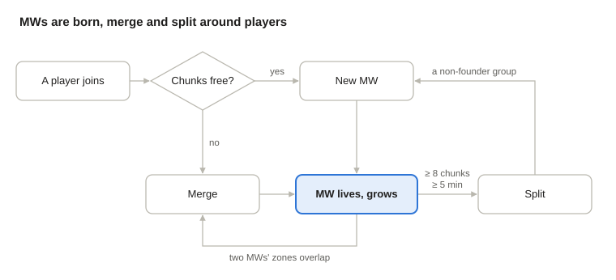

# 3. Micro worlds (MW)

*English · [Українська](../uk/docs/03-mikrosvity.md)*

An MW is the unit of game logic: one game loop that holds leases on its zone of chunks. At any moment every player belongs to exactly one MW. Inside an MW everything runs on one thread in vanilla's order, and that is what gives 1:1 behaviour.

A merge happens as soon as zones overlap, a split only after a stable gap. So MWs do not "flicker" between these states.

### Zone and leases

An MW's zone is the union of squares of view-distance radius around each of its players. The MW holds AnvilDB leases on every chunk of its zone, so nobody else can change them.

- Within **simulation distance**, chunks are ticked.
- The rest of the zone is loaded and sent to clients, but not ticked.
- Chunks outside any zone are frozen, as in vanilla. The world does not live where there are no players.

Since the merge already happens at view distance, players of different MWs never see each other's chunks. So neither "shadow" entities nor subscriptions to other MWs' chunks are needed.

### Birth

1. A player connects, and IO assigns it a worker.
2. The worker asks AnvilDB for leases on the zone around the player's position.
3. If all chunks are free, a new MW is born, and this player becomes its **founder**.
4. If even one chunk is already leased, the player goes straight into the owning MW through the merge procedure.

### Growth

When a player moves, the zone moves with it. The worker leases the new chunks and releases the old ones after saving them to AnvilDB.

### Merge

**Condition:** MW B tries to lease a chunk already leased by MW A, that is, their zones met at view distance. The initiator is always the worker.

1. AnvilDB refuses B the lease and names the owner: MW A on worker W(A).
2. Worker B stops ticking its MW and serializes all its state: players, entities, block entities, scheduled ticks, leases.
3. The state goes to worker A over the Worker↔Worker channel. If both MWs are on the same worker, the transfer happens in memory.
4. AnvilDB atomically rewrites B's leases to A.
5. If the workers differ, IO switches B's players' connections to worker A.
6. MW A takes in the state and goes on ticking. MW B is destroyed.

The client does not reconnect; it only sees a short pause. The target merge duration is at most 200 ms.

**Simultaneous merge:** if A and B run into each other in the same tick, the MW with the lower ID absorbs the other. *(Proposal.)*

### Split

**Condition:** the players of one MW formed two or more groups whose zones are at least **8 free chunks** apart, and this has lasted at least **5 minutes**. Both values are configurable.

1. The group with the MW's founder stays in it.
2. For every other group the worker creates a new MW. Its founder is a player who had no MW of its own.
3. The chunks, entities and leases of the group's zone go to the new MW.
4. The new MW may later migrate to another worker to balance the load.

**Why there is no "flicker":** a merge happens at zero gap between zones, a split only at a gap of 8 chunks for 5 minutes. This hysteresis keeps MWs from merging and splitting endlessly.

### Limits

One MW ticks on one core. Depending on the CPU, the practical limit is **200–500 players** in one MW. There is no mechanism to divide a dense MW: if a thousand players gather in one spot, the server will be slower there, and that is a deliberate trade-off.

### Defaults

| Parameter | Value | Status |
| --- | --- | --- |
| Zone radius | the server's view distance | decided |
| Split gap | 8 chunks | decided |
| Time before a split | 5 min | decided |
| Longest merge pause | 200 ms | decided |
| Save interval | 5 s | decided |
| Lease TTL | 10 s | proposal |

---

[← 2. Glossary](02-hlosarii.md) · [Contents](../README.md) · [4. Cluster architecture →](04-arkhitektura.md)
