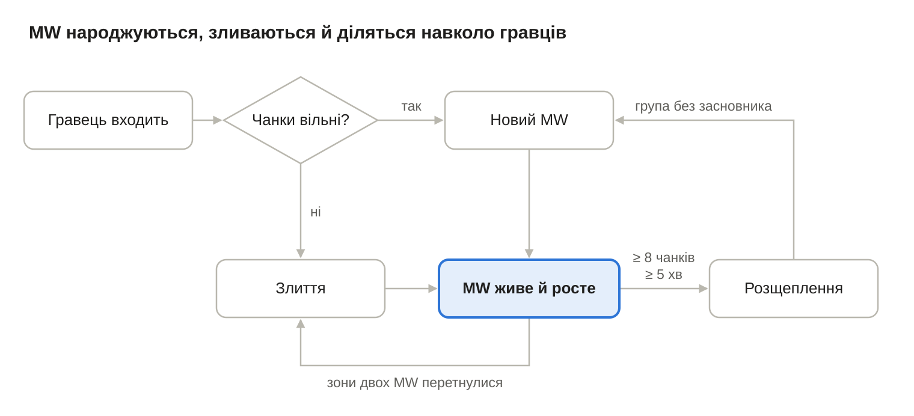

# 3. Мікросвіти (MW)

MW — це одиниця ігрової логіки: один game loop, що володіє орендами на свою зону чанків. Кожен гравець у будь-який момент належить рівно одному MW. Усередині MW усе працює в одному потоці й у ванільному порядку, і саме це дає поведінку 1:1.

*Векторна версія: [mw-lifecycle.svg](../images/mw-lifecycle.svg)*

Злиття стається одразу, як тільки зони перетнулися, а розщеплення — лише після стабільного розриву. Тому MW не «миготять» між цими станами.

## Зона та оренди

Зона MW — це об'єднання квадратів радіусом view distance навколо кожного його гравця. На всі чанки зони MW тримає оренди в AnvilDB, тож ніхто інший не може їх змінювати.

- У межах **simulation distance** чанки тікаються.
- Решта зони завантажена й надсилається клієнтам, але не тікається.
- Чанки поза будь-якою зоною заморожені, як у ванілі. Світ не живе там, де немає гравців.

Оскільки злиття відбувається вже на view distance, гравці з різних MW ніколи не бачать чанків одне одного. Тому не потрібні ні «тіньові» сутності, ні підписки на чужі чанки.

## Народження

1. Гравець підключається, IO призначає йому воркер.
2. Воркер запитує в AnvilDB оренди на зону навколо позиції гравця.
3. Якщо всі чанки вільні, народжується новий MW, і цей гравець стає його **засновником**.
4. Якщо хоч один чанк уже орендований, гравець одразу потрапляє в MW-власника за процедурою злиття.

## Ріст

Коли гравець рухається, зона зсувається. Воркер дозамовляє оренди на нові чанки й звільняє старі після того, як збереже їх в AnvilDB.

## Злиття

**Умова:** MW B намагається орендувати чанк, який уже орендований MW A, тобто їхні зони на view distance перетнулися. Ініціатором завжди є воркер.

1. AnvilDB відмовляє B в оренді й повідомляє власника: MW A на воркері W(A).
2. Воркер B зупиняє тік свого MW і серіалізує весь стан: гравців, сутності, блоки-сутності, заплановані тіки, оренди.
3. Стан передається воркеру A по каналу Worker↔Worker. Якщо обидва MW на одному воркері, передача відбувається в пам'яті.
4. AnvilDB атомарно переписує оренди B на A.
5. Якщо воркери різні, IO перемикає з'єднання гравців B на воркер A.
6. MW A вбудовує отриманий стан і продовжує тік. MW B знищується.

Клієнт не перепідключається, а бачить лише коротку паузу. Цільова тривалість злиття — не більше 200 мс.

**Одночасне злиття:** якщо A і B натрапили одне на одного в одному тіку, поглинає той MW, у якого менший ідентифікатор. *(Пропозиція.)*

## Розщеплення

**Умова:** гравці всередині одного MW утворили дві чи більше групи, між зонами яких є щонайменше **8 вільних чанків**, і такий стан триває не менше **5 хвилин**. Обидва значення налаштовуються.

1. Група, у якій є засновник MW, залишається в ньому.
2. Для кожної іншої групи воркер створює новий MW. Засновником стає гравець, який не мав власного MW.
3. Чанки, сутності й оренди зони групи переходять до нового MW.
4. Новий MW може пізніше мігрувати на інший воркер для балансування навантаження.

**Чому немає «миготіння»:** злиття відбувається при нульовому зазорі між зонами, а розщеплення — лише при зазорі від 8 чанків протягом 5 хвилин. Цей гістерезис не дає MW безкінечно зливатися й ділитися.

## Межі

Один MW тікається на одному ядрі. Залежно від процесора практична межа — **200–500 гравців** в одному MW. Механізму розділення щільного MW немає: якщо тисяча гравців збереться в одній точці, сервер у цьому місці працюватиме повільніше, і це свідомий компроміс.

## Параметри за замовчуванням

| Параметр | Значення | Статус |
| --- | --- | --- |
| Радіус зони | view distance сервера | рішення |
| Зазор для розщеплення | 8 чанків | рішення |
| Час до розщеплення | 5 хв | рішення |
| Максимальна пауза злиття | 200 мс | рішення |
| Інтервал збереження | 5 с | рішення |
| TTL оренди | 10 с | пропозиція |

---

[← 2. Глосарій](02-hlosarii.md) · [Зміст](../README.md) · [4. Архітектура кластера →](04-arkhitektura.md)
