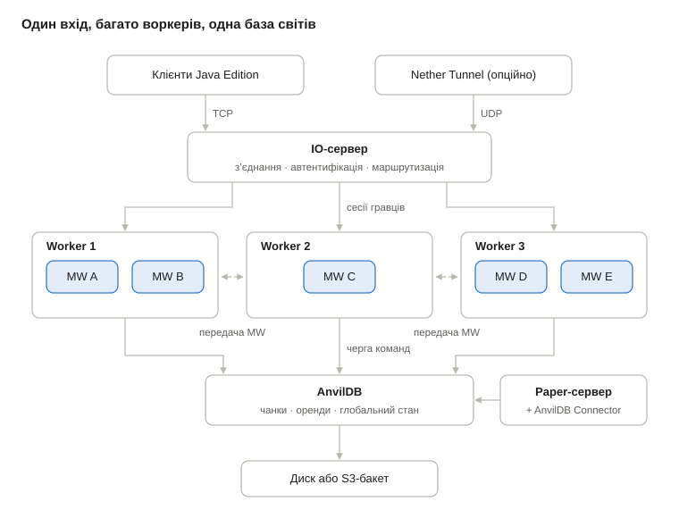

# 4. Cluster architecture

*English · [Українська](../uk/docs/04-arkhitektura.md)*

Sculk is built like a web service: an entry server for incoming traffic (IO), processing servers (Worker) and a central database (AnvilDB). All three roles live in **one Rust binary**, and the role is chosen at start.

Players connect only to IO, which spreads them over the workers. Workers tick MWs, hand them to each other on merges and migrations, and keep the world in AnvilDB through a command queue.

### One binary, three roles

| Command | Role | Instances |
| --- | --- | --- |
| `sculk io` | Player entry, authentication, worker management | 1 (in v1) |
| `sculk worker` | Game logic, MW ticks | As many as you like |
| `sculk anvildb` | Database of worlds and leases | 1 |

One binary makes deployment simpler and guarantees that every service speaks the same protocol version. For a small server all three roles can run on one machine; for a large one they spread over a cluster. Since AnvilDB also serves regular Paper servers, it can run apart from the rest of Sculk.

---

[← 3. Micro worlds (MW)](03-mikrosvity.md) · [Contents](../README.md) · [5. IO server →](05-io-server.md)
