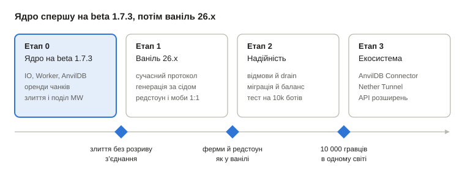

# 14. Roadmap

*English · [Українська](../uk/docs/14-dorozhnia-karta.md)*

The distributed core is first proven on beta 1.7.3, whose code base is many times smaller. The MW, lease and AnvilDB mechanisms do not depend on the game version, so the project then moves to the modern version 26.x.

Diamonds are checkpoints: the next stage starts once the condition under the diamond holds. The order of stages 2 and 3 is a proposal, and part of stage 3 (such as AnvilDB Connector) can be done alongside stage 1. Ideas outside this plan are in chapter 15.

---

[← 13. Limitations and open questions](13-obmezhennia.md) · [Contents](../README.md) · [15. Future ideas →](15-maibutni-idei.md)
