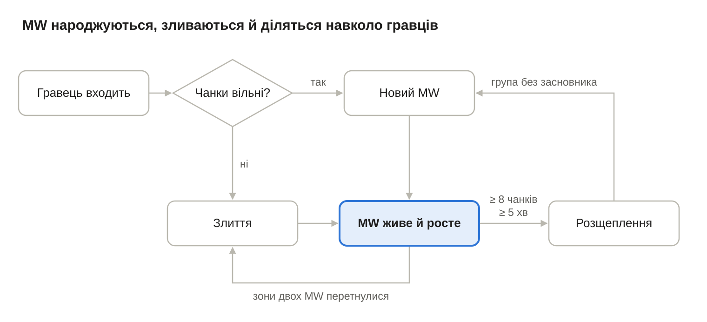
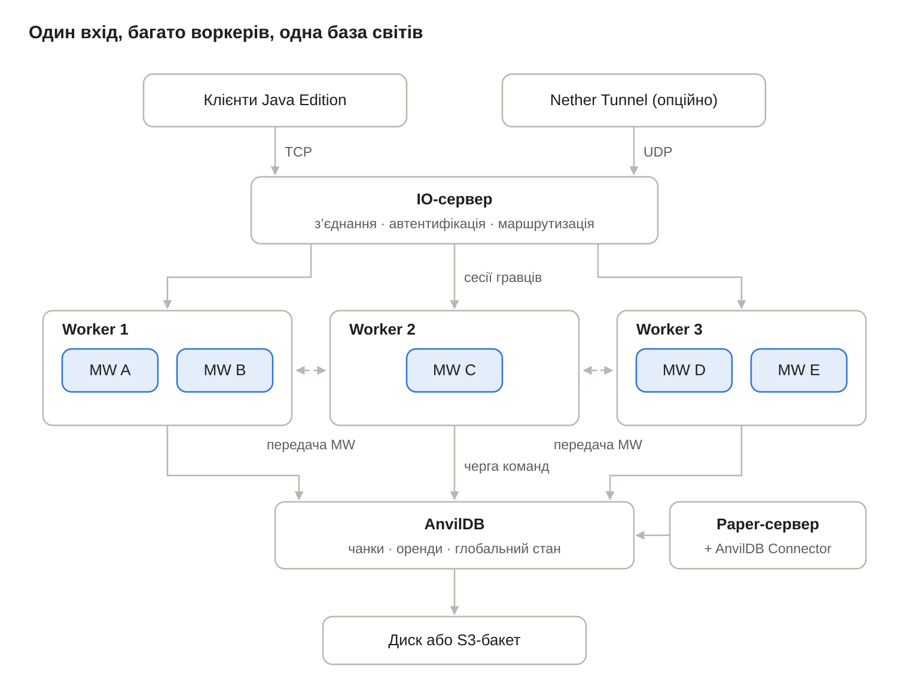
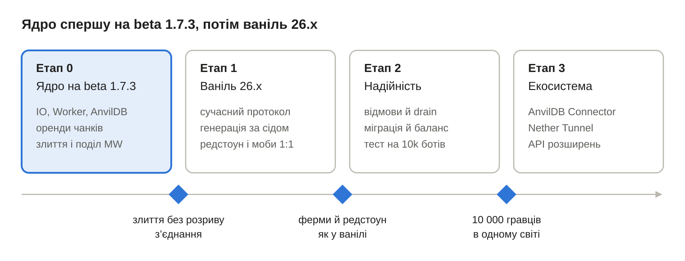

# Sculk — концепція розподіленого Minecraft-сервера

*[English](../SCULK.md) · Українська*

7 листопада 2026

## 1. Вступ і мета

Sculk — це open source сервер Minecraft: Java Edition на Rust. Його мета — 10 000+ гравців в одному безшовному світі, з поведінкою, яку гравець не відрізнить від ванільного сервера.

### Проблема

Ванільний сервер має один game loop: 20 тіків на секунду, тобто 50 мс на тік. Усі чанки, сутності та гравці обробляються в одному потоці. Додаткові ядра процесора майже не допомагають, і тому навіть потужний сервер упирається в кілька сотень гравців.

### Ідея: світ як організм із клітин

Замість одного game loop Sculk запускає тисячі незалежних — **мікросвітів (MW, Micro World)**. Кожен гравець завжди живе в одному MW, а MW поводиться як маленький ванільний сервер із власними мобами, тіками й редстоуном.

MW поводяться як клітини:

- **ростуть** разом із пересуванням гравців;
- **зливаються**, коли гравці підходять одне до одного;
- **діляться**, коли гравці надовго розходяться.

Оскільки на великих серверах гравці зазвичай розкидані по карті, тисячі MW тікаються паралельно на багатьох ядрах і багатьох машинах.

### Чим Sculk відрізняється від схожих проєктів

- **Folia** (PaperMC) ділить світ на регіони, що зливаються й діляться, але працює в межах одного процесу.
- **MultiPaper** розподіляє власність чанків між кількома серверами, але кожен сервер залишається звичайним Paper.
- **Sculk** прив'язує регіони до гравців, розносить їх по кластеру воркерів, зберігає світ в окремій СУБД **AnvilDB** і пишеться з нуля на Rust.

### Що не є метою

- Тисяча гравців в одній точці. Один MW обмежений одним ядром, і це свідомий компроміс (розділ 13).
- Підтримка модів і Java-плагінів Paper.

Проєкт розпочато у 2023 році під назвою IWM ([прототип](https://github.com/DmytroFrame/iwm)). Sculk — його нове ім'я та переосмислена архітектура.

## 2. Глосарій

Власні назви компонентів залишаються англійською, решта термінів — українською.

| Термін | Значення |
| --- | --- |
| **MW (Micro World)** | Мікросвіт: незалежний game loop, який володіє набором чанків і обробляє всіх гравців і сутності в них |
| **Зона MW** | Усі чанки в межах view distance навколо кожного гравця цього MW |
| **Оренда (lease)** | Виключне право MW читати й писати чанк. Видається AnvilDB, має строк дії (TTL) і продовжується |
| **Злиття (merge)** | Передача всього стану одного MW іншому, коли їхні зони перетинаються |
| **Розщеплення (split)** | Виділення групи гравців у новий MW, коли вони надовго віддалилися від решти |
| **IO** | Сервер входу: тримає з'єднання клієнтів, автентифікує, керує воркерами |
| **Worker** | Сервер обробки: тікає багато MW одночасно. Має 16-бітний Worker ID від IO |
| **AnvilDB** | СУБД світів Minecraft: чанки, глобальний стан, оренди |
| **Entity ID** | Ціле число, яким протокол Java позначає сутність у пакетах. Діє лише під час роботи |
| **UUID** | Постійний ідентифікатор сутності чи гравця в сховищі |
| **View distance** | Радіус чанків, які сервер надсилає клієнту |
| **Simulation distance** | Радіус чанків, у яких відбуваються тіки |
| **Nether Tunnel** | Опційна клієнтська програма з власним UDP-транспортом |
| **AnvilDB Connector** | Плагін для Paper-серверів, що дає їм зберігати світи в AnvilDB |

## 3. Мікросвіти (MW)

MW — це одиниця ігрової логіки: один game loop, що володіє орендами на свою зону чанків. Кожен гравець у будь-який момент належить рівно одному MW. Усередині MW усе працює в одному потоці й у ванільному порядку, і саме це дає поведінку 1:1.

*Векторна версія: [mw-lifecycle.svg](../images/mw-lifecycle.uk.svg)*

Злиття стається одразу, як тільки зони перетнулися, а розщеплення — лише після стабільного розриву. Тому MW не «миготять» між цими станами.

### Зона та оренди

Зона MW — це об'єднання квадратів радіусом view distance навколо кожного його гравця. На всі чанки зони MW тримає оренди в AnvilDB, тож ніхто інший не може їх змінювати.

- У межах **simulation distance** чанки тікаються.
- Решта зони завантажена й надсилається клієнтам, але не тікається.
- Чанки поза будь-якою зоною заморожені, як у ванілі. Світ не живе там, де немає гравців.

Оскільки злиття відбувається вже на view distance, гравці з різних MW ніколи не бачать чанків одне одного. Тому не потрібні ні «тіньові» сутності, ні підписки на чужі чанки.

### Народження

1. Гравець підключається, IO призначає йому воркер.
2. Воркер запитує в AnvilDB оренди на зону навколо позиції гравця.
3. Якщо всі чанки вільні, народжується новий MW, і цей гравець стає його **засновником**.
4. Якщо хоч один чанк уже орендований, гравець одразу потрапляє в MW-власника за процедурою злиття.

### Ріст

Коли гравець рухається, зона зсувається. Воркер дозамовляє оренди на нові чанки й звільняє старі після того, як збереже їх в AnvilDB.

### Злиття

**Умова:** MW B намагається орендувати чанк, який уже орендований MW A, тобто їхні зони на view distance перетнулися. Ініціатором завжди є воркер.

1. AnvilDB відмовляє B в оренді й повідомляє власника: MW A на воркері W(A).
2. Воркер B зупиняє тік свого MW і серіалізує весь стан: гравців, сутності, блоки-сутності, заплановані тіки, оренди.
3. Стан передається воркеру A по каналу Worker↔Worker. Якщо обидва MW на одному воркері, передача відбувається в пам'яті.
4. AnvilDB атомарно переписує оренди B на A.
5. Якщо воркери різні, IO перемикає з'єднання гравців B на воркер A.
6. MW A вбудовує отриманий стан і продовжує тік. MW B знищується.

Клієнт не перепідключається, а бачить лише коротку паузу. Цільова тривалість злиття — не більше 200 мс.

**Одночасне злиття:** якщо A і B натрапили одне на одного в одному тіку, поглинає той MW, у якого менший ідентифікатор. *(Пропозиція.)*

### Розщеплення

**Умова:** гравці всередині одного MW утворили дві чи більше групи, між зонами яких є щонайменше **8 вільних чанків**, і такий стан триває не менше **5 хвилин**. Обидва значення налаштовуються.

1. Група, у якій є засновник MW, залишається в ньому.
2. Для кожної іншої групи воркер створює новий MW. Засновником стає гравець, який не мав власного MW.
3. Чанки, сутності й оренди зони групи переходять до нового MW.
4. Новий MW може пізніше мігрувати на інший воркер для балансування навантаження.

**Чому немає «миготіння»:** злиття відбувається при нульовому зазорі між зонами, а розщеплення — лише при зазорі від 8 чанків протягом 5 хвилин. Цей гістерезис не дає MW безкінечно зливатися й ділитися.

### Межі

Один MW тікається на одному ядрі. Залежно від процесора практична межа — **200–500 гравців** в одному MW. Механізму розділення щільного MW немає: якщо тисяча гравців збереться в одній точці, сервер у цьому місці працюватиме повільніше, і це свідомий компроміс.

### Параметри за замовчуванням

| Параметр | Значення | Статус |
| --- | --- | --- |
| Радіус зони | view distance сервера | рішення |
| Зазор для розщеплення | 8 чанків | рішення |
| Час до розщеплення | 5 хв | рішення |
| Максимальна пауза злиття | 200 мс | рішення |
| Інтервал збереження | 5 с | рішення |
| TTL оренди | 10 с | пропозиція |

## 4. Архітектура кластера

Sculk побудований як вебсервіс: є сервер вхідного трафіку (IO), сервери обробки (Worker) і централізована база даних (AnvilDB). Усі три ролі живуть в **одному бінарнику Rust**, а роль задається при запуску.

*Векторна версія: [architecture.svg](../images/architecture.uk.svg)*

Гравці підключаються лише до IO, який розподіляє їх по воркерах. Воркери тікають MW, передають їх одне одному при злитті й міграції та зберігають світ в AnvilDB через чергу команд.

### Один бінарник — три ролі

| Команда | Роль | Скільки інстансів |
| --- | --- | --- |
| `sculk io` | Вхід гравців, автентифікація, керування воркерами | 1 (у v1) |
| `sculk worker` | Ігрова логіка, тік MW | Скільки завгодно |
| `sculk anvildb` | СУБД світів і оренд | 1 |

Один бінарник спрощує розгортання й гарантує, що всі сервіси говорять однією версією протоколу. Для невеликого сервера всі три ролі можна запустити на одній машині, а для великого — рознести по кластеру. Оскільки AnvilDB обслуговує й звичайні Paper-сервери, її можна запускати окремо від решти Sculk.

## 5. IO-сервер

IO — єдина точка входу в кластер. Він тримає всі з'єднання Java-клієнтів і керує воркерами, але сам не виконує ігрової логіки. У v1 IO-сервер один (обмеження й шлях розвитку — у розділах 13 і 15).

### Обов'язки

- **Прийом з'єднань:** handshake, status/ping для списку серверів, login.
- **Автентифікація:** перевірка гравця через сесійний сервер Mojang і шифрування з'єднання.
- **Реєстр воркерів:** видача 16-бітних Worker ID, heartbeat, облік навантаження кожного воркера.
- **Розподіл:** новий гравець потрапляє на найменш навантажений воркер. Якщо його зона перетинається з існуючим MW, гравець іде на воркер-власник.
- **Маршрутизація:** таблиця «сесія → воркер». При злитті чи міграції MW IO перемикає маршрут без розриву з'єднання.
- **Видача entity ID** блоками воркерам (розділ 9).
- **Глобальний чат і таб-лист**, бо лише IO бачить усіх гравців одночасно. *(Пропозиція.)*

### Розподіл роботи з пакетами

Щоб IO не став вузьким місцем на 10 000 гравців, важку роботу з пакетами виконують воркери. *(Пропозиція.)*

- Воркер формує ігрові пакети й **стискає** їх.
- IO лише **шифрує** вже стиснений потік і відправляє клієнту.
- Між IO і воркером пакети гравця передаються як непрозорі байти, без повторного кодування в protobuf.

### Збереження з'єднання при відмові воркера

1. IO помічає, що воркер не відповідає на heartbeat.
2. З'єднання з клієнтами не рветься: IO сам відповідає на keep-alive.
3. IO звільняє оренди мертвого воркера в AnvilDB.
4. Гравці призначаються іншим воркерам, які відновлюють їхні MW з останнього збереженого стану.
5. Клієнт отримує повторну синхронізацію світу й позиції, тобто бачить коротке «замерзання» замість кіку.

Втрата прогресу обмежена інтервалом збереження (5 с).

### Планований перезапуск воркера (drain)

IO переводить воркер у режим drain: нових гравців він не отримує, а всі його MW мігрують на інші воркери тим самим механізмом, що й злиття. Після цього воркер можна безпечно перезапустити.

## 6. Worker

Worker виконує ігрову логіку для багатьох MW одночасно. Воркер можна вважати «процесором клітин»: він не знає про світ загалом, лише про MW, які йому доручили.

### Модель потоків

- Пул потоків ОС за кількістю ядер.
- Кожні 50 мс планувальник розкладає MW по потоках. Один MW у будь-який момент тікається лише в одному потоці, тому всередині MW логіка однопотокова й детермінована, як у ванілі.
- Малі MW ділять потік між собою. Великий MW займає ядро повністю.
- Мережева робота (з'єднання з IO, AnvilDB та іншими воркерами) йде в окремому асинхронному рантаймі Tokio і не блокує тіки.

### Тік MW

Тік повторює порядок ванільного сервера: вхідні пакети гравців, час і погода (з глобального годинника), тіки чанків, заплановані тіки блоків, сутності, блоки-сутності, вихідні пакети. Мета — щоб редстоун, ферми й механіки поводилися точно як у ванілі.

### З'єднання з AnvilDB

Кожен воркер тримає одне постійне з'єднання з AnvilDB із **чергою команд**:

- запити оренд, продовження та звільнення;
- завантаження чанків;
- асинхронне скидання змінених чанків кожні ~5 с;
- читання й запис глобального стану й даних гравців.

Черга дозволяє групувати команди в пакети й не чекати відповіді там, де вона не потрібна.

### Генерація світу

Нові чанки генерує воркер за сідом світу й одразу передає їх в AnvilDB. Генерація має збігатися з ваніллю, щоб той самий сід давав той самий світ. Воркер також може працювати з власними типами блоків і сутностей проєкту.

### Міграція MW між воркерами

Для балансування навантаження або перед перезапуском MW переїжджає на інший воркер тим самим механізмом, що й при злитті: заморозити, серіалізувати, передати, переписати оренди, перемкнути маршрути в IO, продовжити тік.

## 7. AnvilDB

AnvilDB — окрема СУБД для світів Minecraft. Вона зберігає чанки й глобальний стан, видає оренди на чанки й працює через protobuf. Нею можуть користуватися як воркери Sculk, так і звичайні Java-сервери через плагін (розділ 12).

### Модель даних

Структура схожа на реляційну СУБД:

- **база даних** → містить **світи**;
- **світ** → містить **виміри** (overworld, nether, end, власні), які працюють як таблиці;
- **вимір** → містить регіони та чанки, а також метадані чанків.

На рівні світу зберігається глобальний стан: час доби, погода, gamerules, world border, scoreboard, дані гравців (інвентар, позиція, статистика).

### Оренди чанків

AnvilDB — єдине джерело правди про те, хто володіє чанком. Для кожного чанка вона знає MW, воркер і строк дії оренди.

| Операція | Що робить |
| --- | --- |
| `acquire` | Атомарно бере оренду на набір чанків. Якщо хоч один зайнятий, повертає власника |
| `renew` | Продовжує оренди, поки воркер живий |
| `release` | Звільняє оренди після збереження чанків |
| `transfer` | Атомарно передає оренди від MW до MW при злитті, розщепленні чи міграції |
| `owner` | Повертає метадані чанка й поточного власника |

Кожна оренда має **номер покоління** (fencing token). Запис зі старим номером відхиляється, тож воркер, який «завис» і втратив оренду, не зможе зіпсувати дані. *(Пропозиція.)*

### Формати зберігання

- **Класичний** — сумісний з Anvil (`.mca`), щоб світ можна було взяти зі звичайного сервера й повернути назад.
- **Оптимізований** — власний формат AnvilDB для швидкого читання, запису та кращого стиснення.

Для переносу світів між форматами є CLI-інструмент для імпорту й експорту. Його логічно зробити підкомандою того ж бінарника: `sculk anvildb import` / `sculk anvildb export`. *(Пропозиція.)*

### Сховище й архів

- Файли зберігаються на локальному диску інстансу або в **S3-сумісному бакеті**.
- Регіони, які давно ніхто не відвідував, переходять в **архів**: сильніше стискаються й переносяться в холодне сховище. Коли гравець туди приходить, вони повертаються за запитом.

## 8. Протоколи між сервісами

Усі внутрішні сервіси спілкуються через protobuf. Транспорт — gRPC із двонаправленими потоками, як у прототипі IWM. Протокол можна замінити на швидший, якщо gRPC виявиться вузьким місцем. Назовні клієнт бачить лише стандартний протокол Java Edition.

| Канал | Транспорт | Що передається |
| --- | --- | --- |
| Клієнт → IO | Java Edition protocol (TCP) або Nether Tunnel (UDP) | Ігровий трафік гравця |
| IO ↔ Worker | gRPC-потік | Пакети гравців як непрозорі байти; команди керування: призначити сесію, перемкнути, drain |
| Worker ↔ Worker | gRPC-потік | Серіалізований стан MW при злитті, розщепленні чи міграції |
| Worker ↔ AnvilDB | gRPC-потік із чергою команд | Оренди, чанки, глобальний стан, дані гравців |
| IO ↔ AnvilDB | gRPC | Звільнення оренд мертвих воркерів, глобальний стан |
| AnvilDB Connector ↔ AnvilDB | gRPC | Чанки та стан світу для звичайних Paper-серверів |

Один бінарник містить усі ролі, тому `.proto`-схеми й код серіалізації спільні для всіх сервісів і не можуть розійтися між версіями.

## 9. Глобальний стан та ідентифікатори

Усе, що стосується світу загалом, живе в AnvilDB, а все локальне — у MW на воркері. Ідентифікатори сутностей видаються так, щоб злиття ніколи не вимагало перенумерації.

### Що де живе

| Дані | Де | Хто змінює |
| --- | --- | --- |
| Час доби, погода, gamerules, world border, scoreboard | AnvilDB | Лише AnvilDB рахує час; MW змінюють стан командою в AnvilDB (наприклад `/time set`) |
| Дані гравців | AnvilDB | MW, у якому зараз гравець |
| Чанки та блоки | AnvilDB | MW, що тримає оренду |
| Селяни, рейди, Ender Dragon, інші локальні механіки | Worker, у MW | Сам MW |
| Чат, таб-лист | IO | IO *(пропозиція)* |

Воркери періодично синхронізують годинник з AnvilDB, тому всі MW бачать однаковий час доби.

### Entity ID

У протоколі Java UUID передається лише в пакеті появи сутності. Усі наступні пакети (рух, метадані, удар, знищення) посилаються на ціле число entity ID. У beta 1.7.3 UUID немає взагалі. Якщо два MW видадуть однакові ID, після злиття клієнт переплутає сутності.

**Рішення:** entity ID глобально унікальні в межах кластера.

1. IO видає воркерам ID блоками, наприклад по 4096 штук.
2. Воркер роздає ID зі свого блоку новим сутностям у своїх MW.
3. Коли блок закінчується, воркер просить наступний.
4. При злитті сутності зберігають свої ID, бо вони вже унікальні.

### UUID

UUID — постійна ідентичність гравця чи сутності в сховищі. Entity ID існує лише під час роботи сервера й не зберігається.

## 10. Надійність і відмови

Падіння будь-якого воркера коштує гравцям щонайбільше 5 секунд прогресу й короткого «замерзання». Падіння IO у v1 відключає всіх гравців.

### Збереження стану

Воркер тримає чанки своїх MW у пам'яті. Оренда гарантує, що ніхто інший їх не змінює, тому писати кожну зміну синхронно не потрібно. Змінені чанки й дані гравців скидаються в AnvilDB асинхронно:

- кожні ~5 секунд;
- перед звільненням оренди;
- при злитті, міграції та штатній зупинці.

### Сценарії відмов

| Що сталося | Що робить система | Що втрачається |
| --- | --- | --- |
| Воркер упав | IO помічає це за heartbeat, звільняє оренди, переносить гравців на інші воркери, MW відновлюються з AnvilDB | До 5 с прогресу |
| Воркер завис, але живий | Оренди не продовжуються й спливають за TTL. Пізні записи відхиляються за номером покоління | До 5 с прогресу |
| AnvilDB недоступна | MW продовжують тікатися на чанках у пам'яті, записи накопичуються в черзі. Нові оренди не видаються, тож гравці не можуть вийти за межі своїх зон *(пропозиція)* | Нічого, якщо AnvilDB повернеться до переповнення черги |
| IO упав | Усі клієнти відключаються, воркери зберігають стан | Сесії гравців; прогрес зберігається |
| Планований перезапуск воркера | Drain: MW мігрують на інші воркери | Нічого |

## 11. Nether Tunnel

Nether Tunnel — опційна клієнтська програма для тих, кому критична затримка, наприклад для PvP-гравців. Звичайне підключення через TCP залишається основним, і для гри Nether Tunnel не потрібен.

### Як це працює

1. Гравець запускає Nether Tunnel, і той відкриває локальну адресу, наприклад `127.0.0.1:25565`.
2. Клієнт Minecraft підключається до цієї адреси, як до звичайного сервера.
3. Nether Tunnel загортає Java-трафік у власний протокол поверх UDP із сильнішим стисненням і відправляє на IO.
4. IO розгортає трафік і обробляє його як звичайну сесію.

### Звідки виграш

Клієнт Minecraft однаково очікує впорядкований потік, тож Nether Tunnel доставляє дані по порядку. Виграш з'являється на ділянці між гравцем і сервером:

- швидша повторна передача втрачених пакетів, без затримок механізму відновлення TCP;
- можливість додати надлишкове кодування (FEC), щоб частину втрат відновлювати без повторної передачі;
- сильніше стиснення зі спільним словником для типових пакетів Minecraft.

Найбільший ефект очікується в гравців із нестабільним інтернетом або далеко від сервера. На хорошому каналі різниця буде мінімальною, і це варто чесно вказати в документації для гравців.

## 12. Розширення та AnvilDB Connector

У Sculk буде власне API розширень, а Java-плагіни Paper всередині Sculk не запускатимуться. Натомість звичайні Paper-сервери зможуть підключатися до AnvilDB через окремий плагін.

### API Sculk

Розширення пишуться під власне API. Плагіни Paper написані на Java, і для їх запуску всередині Rust-сервера потрібно було б вбудовувати JVM, а це складно й повільно.

**Відкрите питання:** нативні Rust-розширення чи WASM-модулі. WASM дає ізоляцію (плагін не може «покласти» воркер) і дозволяє писати розширення різними мовами, але додає накладні витрати на виклики.

### AnvilDB Connector

AnvilDB — повноцінна СУБД, яку не вмістити в плагін. AnvilDB Connector — легкий плагін для Paper-серверів, який підключається до AnvilDB як клієнт.

- Перехоплює завантаження й збереження чанків і працює з ними через AnvilDB замість локальних `.mca`.
- Дає звичайним серверам S3-сховище, архів і оптимізований формат.
- Реалізація залежить від того, наскільки просто перехопити код запису й завантаження світу в Paper. Підтримку Bukkit/Spigot варто вирішувати після цього.

Оскільки Connector працює з тими самими орендами, у майбутньому звичайний Paper-сервер може стати «одним MW» у спільному світі зі Sculk. Це не мета v1, але архітектура такого не забороняє.

## 13. Обмеження та відкриті питання

Архітектура масштабується за рахунок того, що гравці розкидані по світу. Вона свідомо жертвує сценаріями, де дуже багато людей збираються в одному місці.

### Прийняті компроміси

| Обмеження | Наслідок | Чому прийнятно |
| --- | --- | --- |
| Один MW = одне ядро | Понад 200–500 гравців в одній точці сповільнюють тік цього MW | Решта світу при цьому не страждає |
| Один IO-сервер | Єдина точка відмови й вузьке місце за трафіком | Спрощує v1; шлях розвитку — розділ 15 |
| Пауза злиття | До ~200 мс «замерзання» у гравців, що зливаються | Відбувається рідко й лише при зближенні |
| Асинхронне збереження | До 5 с втраченого прогресу при падінні воркера | Звичайні сервери при падінні втрачають більше |
| Світ без гравців заморожений | Ферми далеко від гравців не працюють | Так само працює й ваніль |

### Найбільший обсяг роботи

Повторення ванілі 1:1 з нуля на Rust — найскладніша частина проєкту, складніша за саму розподілену архітектуру. Генерація світу має збігатися за сідом, а редстоун має повторювати всі нюанси, на які спираються технічні гравці. Варто вивчити Rust-сервер Pumpkin: частину протоколу чи генерації, можливо, вдасться перевикористати.

### Відкриті питання

- [ ] Пропуск ночі: як рахувати сплячих гравців на 10 000 людей — по всьому світу чи інакше?
- [ ] Чи підтримувати постійно завантажені чанки спавну?
- [ ] API розширень: нативний Rust чи WASM?
- [ ] Точне значення TTL оренди та розмір блоку entity ID.
- [ ] Хто поглинає кого при одночасному злитті (пропозиція — менший ID MW).

## 14. Дорожня карта

Розподілене ядро спершу обкатується на beta 1.7.3, бо її кодова база в рази менша. Механізми MW, оренд і AnvilDB не залежать від версії гри, тому після цього проєкт переходить на сучасну версію 26.x.

*Векторна версія: [roadmap.svg](../images/roadmap.uk.svg)*

Ромби — контрольні точки: наступний етап починається, коли виконана умова під ромбом. Порядок етапів 2 і 3 — пропозиція, і частину етапу 3 (наприклад AnvilDB Connector) можна робити паралельно з етапом 1. Ідеї поза цим планом — у розділі 15.

## 15. Майбутні ідеї

Ці ідеї не входять у план реалізації, але архітектура не повинна їх унеможливлювати.

### Кілька IO: координатор і шлюзи

Щоб прибрати єдину точку відмови, IO можна розділити на дві ролі:

- **координатор** — один, з гарячим резервом. Лише він ухвалює рішення: реєстр воркерів, маршрути, видача ID;
- **шлюзи** — скільки завгодно, без стану. Вони лише тримають з'єднання клієнтів, шифрують і пересилають пакети за маршрутами від координатора.

Колізій кластера не виникає, бо рішення ухвалює лише одна сторона. Падіння шлюзу відключає лише його гравців, а падіння координатора обробляє резерв.

### GPU на воркерах

Воркер може передавати на GPU масові обчислення, наприклад пошук шляху для тисяч мобів одночасно. Логіка MW при цьому має залишатися детермінованою, тож результати GPU мають бути такими самими, як у ванільного алгоритму.

### Розділення щільних MW

Якщо колись з'явиться потреба в тисячах гравців в одній точці, можна дослідити ділення одного MW на кілька потоків усередині, як це робить Folia. Зараз це свідомо не планується.
