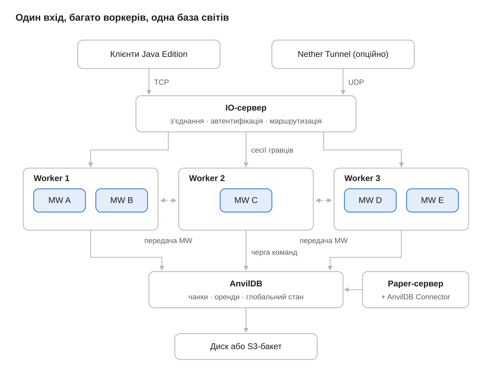

# 4. Архітектура кластера

*[English](../../docs/04-arkhitektura.md) · Українська*

Sculk побудований як вебсервіс: є сервер вхідного трафіку (IO), сервери обробки (Worker) і централізована база даних (AnvilDB). Усі три ролі живуть в **одному бінарнику Rust**, а роль задається при запуску.

*Векторна версія: [architecture.svg](../../images/architecture.uk.svg)*

Гравці підключаються лише до IO, який розподіляє їх по воркерах. Воркери тікають MW, передають їх одне одному при злитті й міграції та зберігають світ в AnvilDB через чергу команд.

## Один бінарник — три ролі

| Команда | Роль | Скільки інстансів |
| --- | --- | --- |
| `sculk io` | Вхід гравців, автентифікація, керування воркерами | 1 (у v1) |
| `sculk worker` | Ігрова логіка, тік MW | Скільки завгодно |
| `sculk anvildb` | СУБД світів і оренд | 1 |

Один бінарник спрощує розгортання й гарантує, що всі сервіси говорять однією версією протоколу. Для невеликого сервера всі три ролі можна запустити на одній машині, а для великого — рознести по кластеру. Оскільки AnvilDB обслуговує й звичайні Paper-сервери, її можна запускати окремо від решти Sculk.

---

[← 3. Мікросвіти (MW)](03-mikrosvity.md) · [Зміст](../README.md) · [5. IO-сервер →](05-io-server.md)
