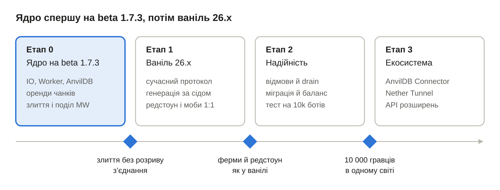

# 14. Дорожня карта

*[English](../../docs/14-dorozhnia-karta.md) · Українська*

Розподілене ядро спершу обкатується на beta 1.7.3, бо її кодова база в рази менша. Механізми MW, оренд і AnvilDB не залежать від версії гри, тому після цього проєкт переходить на сучасну версію 26.x.

*Векторна версія: [roadmap.svg](../../images/roadmap.uk.svg)*

Ромби — контрольні точки: наступний етап починається, коли виконана умова під ромбом. Порядок етапів 2 і 3 — пропозиція, і частину етапу 3 (наприклад AnvilDB Connector) можна робити паралельно з етапом 1. Ідеї поза цим планом — у розділі 15.

---

[← 13. Обмеження та відкриті питання](13-obmezhennia.md) · [Зміст](../README.md) · [15. Майбутні ідеї →](15-maibutni-idei.md)
